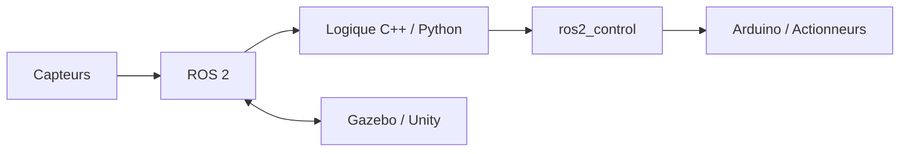

# 👋 Bonjour, je suis Lacina Sidibé

### 🤖 Robotique mobile · ROS 2 · Systèmes embarqués · Simulation

  
  

  Je développe des systèmes robotiques en combinant <strong>ROS 2</strong>,
  <strong>C++</strong>, <strong>Python</strong>, <strong>Arduino</strong> et la simulation.

---

## 🚀 À propos de moi

Je conçois des prototypes robotiques capables de percevoir leur environnement,
communiquer avec leurs composants matériels et se déplacer dans des environnements réels ou simulés.

- 🔭 Je travaille sur la robotique mobile et les architectures ROS 2.
- ⚙️ Je développe des interfaces `ros2_control` pour moteurs, servomoteurs et capteurs.
- 🧠 J'explore la navigation autonome, la simulation Gazebo et les systèmes cyber-physiques.
- 🐍 J'utilise Python pour les nœuds, outils et services, et C++ pour les composants temps réel.
- 🔌 J'intègre Arduino, encodeurs, moteurs DC, IMU et communications série.
- 🤝 Je suis ouvert aux collaborations autour de la robotique et de l'IA appliquée.

## 🧭 Domaines techniques

| Domaine | Technologies |
|---|---|
| Robotique | ROS 2, `ros2_control`, navigation, URDF/Xacro, TF |
| Logiciel | C++, Python, architecture modulaire, API REST |
| Matériel | Arduino, moteurs DC, servomoteurs, encodeurs, MPU6050 |
| Simulation | Gazebo, Unity, environnements robotisés |
| Outils | Linux, Git, GitHub, VS Code, Make |

## 📌 Projets récents

### 🤖 [Diff_robot_real](https://github.com/lacinasidibe114-sudo/Diff_robot_real)

Workspace ROS 2 pour un robot mobile différentiel, avec simulation Gazebo,
pilotage matériel réel, firmware Arduino, encodeurs, PID, odométrie et TF.

`ROS 2` · `C++` · `Python` · `Gazebo` · `Arduino`

### 🏥 [HospiBot](https://github.com/lacinasidibe114-sudo/hospibot)

Système de navigation robotique hospitalière combinant robotique mobile,
simulation, interfaces utilisateur et services d'intelligence artificielle.

`ROS 2` · `Python` · `Gazebo` · `API REST`

### 🎛️ [servo_moteur](https://github.com/lacinasidibe114-sudo/servo_moteur)

Interface ROS 2 `ros2_control` pour piloter une tête robotique Pan/Tilt
avec deux servomoteurs et un Arduino.

`C++` · `ROS 2` · `ros2_control` · `Arduino`

### ⚙️ [jga25_hardware](https://github.com/lacinasidibe114-sudo/jga25_hardware)

Interface matérielle ROS 2 pour un moteur CC JGA25-370 avec encodeur,
pont en H L298N et boucle de vitesse PID.

`C++` · `ROS 2` · `Encodeur` · `PID`

### 🔗 [unity_ros2_ws](https://github.com/lacinasidibe114-sudo/unity_ros2_ws)

Workspace dédié à l'intégration entre Unity et ROS 2 pour la simulation 3D
et l'expérimentation robotique immersive.

`Python` · `ROS 2` · `Unity` · `Simulation`

## 🏗️ Architecture de travail

Cette architecture sépare la perception, la logique applicative, la communication
ROS 2, le contrôle matériel et la simulation afin de faciliter les tests et l'évolution des projets.

## 🧰 Technologies

  

  
  
  

## 📊 Activité GitHub

  
  

---

> Construire des robots fiables en reliant le logiciel, le matériel et la simulation.

### Merci pour votre visite ⭐

