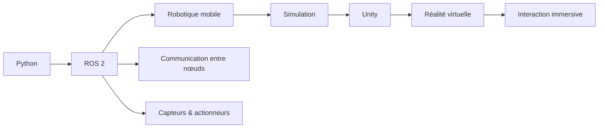
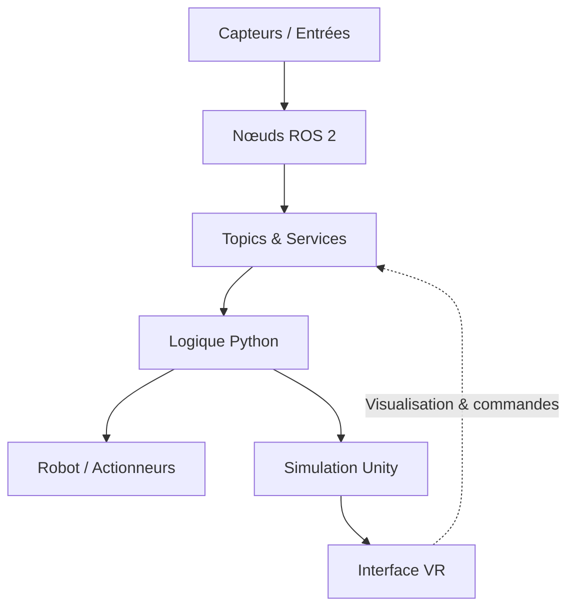

# 👋 Bonjour, je suis Lacina Sidibé

### 🤖 Robotique · ROS 2 · Simulation · Réalité virtuelle · Python

  
  
  

  Je conçois des systèmes robotiques et des environnements de simulation en combinant
  <strong>ROS 2</strong>, <strong>Python</strong>, <strong>Unity</strong> et les technologies immersives.

---

## 🚀 À propos de moi

Je suis passionné par la création de systèmes intelligents capables de percevoir leur environnement,
communiquer entre plusieurs composants et interagir avec le monde réel ou virtuel.

- 🔭 Je travaille sur des projets de **robotique mobile**, de **ROS 2** et de **simulation**.
- 🧠 J’explore l’intégration entre **robotique**, **Unity** et **réalité virtuelle**.
- 🐍 J’utilise principalement **Python** pour développer des nœuds, scripts et outils robotiques.
- 🧩 Je structure mes projets autour d’architectures modulaires et communicantes.
- 🌱 Je continue à approfondir la navigation autonome, la simulation et les systèmes cyber-physiques.
- 🤝 Ouvert aux collaborations dans la robotique, l’IA appliquée et les environnements immersifs.

---

## 🧭 Mon univers technique

### Domaines d’intérêt

| Domaine | Technologies / concepts |
|---|---|
| 🤖 Robotique | ROS 2, nœuds, topics, services, packages |
| 🐍 Développement | Python, scripts d’automatisation, architecture modulaire |
| 🌐 Simulation | Unity, environnements virtuels, scénarios robotisés |
| 🥽 Immersion | Réalité virtuelle, interaction 3D, visualisation |
| 🧪 Expérimentation | Prototypage, intégration logicielle, tests de systèmes |

---

## 📌 Projets sélectionnés

### 🤖 [Last_ros](https://github.com/lacinasidibe114-sudo/Last_ros)
Projet Python orienté **ROS 2**, destiné à l’expérimentation et au développement de fonctionnalités robotiques.

`Python` · `ROS 2` · `Robotique`

---

### 🔗 [unity_ros2_ws](https://github.com/lacinasidibe114-sudo/unity_ros2_ws)
Espace de travail dédié à l’intégration entre **Unity** et **ROS 2**, pour connecter simulation 3D,
communication robotique et expérimentation immersive.

`Python` · `ROS 2` · `Unity` · `Simulation`

---

### 🌐 [VR_Final](https://github.com/lacinasidibe114-sudo/VR_Final)
Projet consacré à la **réalité virtuelle**, à l’interaction 3D et à la conception d’expériences immersives.

`VR` · `Unity` · `3D` · `Interaction immersive`

---

### 🛠️ [ros2_ws](https://github.com/lacinasidibe114-sudo/ros2_ws)
Workspace ROS 2 servant de base pour organiser, compiler et tester des packages et composants robotiques.

`Python` · `ROS 2` · `Workspace`

---

### 📚 [ROS2_TP](https://github.com/lacinasidibe114-sudo/ROS2_TP)
Travaux pratiques et expérimentations autour de **ROS 2**, de ses concepts fondamentaux et du développement robotique.

`ROS 2` · `Robotique` · `Apprentissage`

---

## 🏗️ Architecture type de mes projets

Cette approche permet de séparer clairement :

- la perception et les entrées ;
- la logique applicative ;
- la communication entre composants ;
- les actionneurs et le robot ;
- la simulation et la visualisation immersive.

---

## 🧰 Technologies

  

  
  
  
  

---

## 📊 Activité GitHub

  
  

  

---

## 🎯 Vision

> Construire des expériences robotiques fiables, intelligentes et immersives en reliant le logiciel,
> la simulation et l’interaction humaine.

### Merci pour votre visite ⭐

